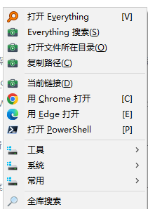
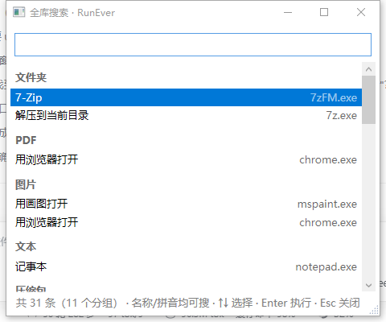

<div align="center">


<h1>RunEver</h1>

<p><strong>选中什么，就只给什么。</strong></p>

[](https://github.com/c-dyang/runever/releases)
[](https://github.com/c-dyang/runever/stargazers)
[](LICENSE)


</div>

## 是什么

**Windows 右键菜单增强。** 选中一个文件、一段文字或一个文件夹，按热键——菜单里只出现跟它相关的几项，点完即走。

不用记快捷键，不用翻工具列表，不用想「该用哪个软件」。

> 它不回答「我能用什么工具」，只回答**「对这个东西、这个场景，我能做什么」**。

| 情境菜单 | 全库搜索 |
|:---:|:---:|
|  |  |
| 选中文件 / 文本 / 空白处，菜单只给此刻相关的条目 | 菜单末项「全库搜索」→ 名称/拼音即时过滤全库条目 |

## ✨ 核心特性

- **情境判定**：`ext / proc / folder / text` 多槽位组合——**同一个文件，在不同程序、不同目录下给不同菜单**
- **一键直达**：扩展名槽位只匹配到**唯一**可执行条目时直接执行，不弹菜单
- **全库搜索**：菜单末项 → 即时过滤全库有效条目（名称子串 + **拼音首字母/全拼**），Enter 直接执行
- **零运行时依赖**：.NET Framework 4.8（系统自带）+ 编译好的 AHK 采集器，无安装器

### 更多能力

- **原生菜单**：Win32 `TrackPopupMenu`——系统级图标、`&` 助记键、真子菜单，不自己画控件
- **文件夹展开**：`open sub <目录>` 在渲染期枚举子项成子菜单，**绝不写回配置**
- **图标全自动**：目标本身是网址的条目自动取站点 favicon；**条目图标不手填**
- **插件系统**：AHK 插件 + 三层声明——**接管（intercept） / 命中派发 / 菜单追加（Menu=true）**
- **22 套无人值守自检**：判定 / 渲染 / 采集 / 插件 / 搜索 / 同步……全绿才算没坏

## 它怎么工作

```
热键
 └─ 采集（CaptureRunner.exe，AHK 常驻管道）
      → 选中文本 / 选中文件(夹) / 前台进程
        └─ 判定（MatchEngine：纯函数、零 IO）
             · 逐条比对分组规则 → 命中的组
             · 合成三个槽位：动态（含兜底） / 进程 / 固定
               └─ 渲染（Win32 TrackPopupMenu，图标 + 助记 + 子菜单）
                    └─ 点击 → 执行（run / open / url / send / cmd / http / group）
```

**三个槽位的语义**（这是 RunEver 的核心模型）：

| 槽位 | 出现条件 | 典型内容 |
|---|---|---|
| 动态 | 选中了文件/文本时命中 `folder` / `ext` / `text` 分组；什么都没选中时由 `fallback` 兜底 | 「压缩包 → 解压到当前目录」「选中文本 → 百度/谷歌」 |
| 进程 | 前台进程命中 `proc` 分组 | 「浏览器 → 用无痕窗口打开」 |
| 固定 | `always` 分组，每次弹出都出现 | 「工具 → 计算器 / 终端」 |

顺序由 `auto.conf` 的 `menuOrder` 决定（默认 `dynamic,process,always`）。**某槽位当次为空就整块不出现** ——
没选中东西又没配 `fallback` 时，「进程」自然排到第一位，这不是顺序失效。

## 可视化配置

不写配置文件也能把 RunEver 调顺：**托盘右键 → 打开设置**。

| 页 | 干什么 |
|---|---|
| **触发与行为** | 弹出热键（显示为键名，如 `Alt+Q`）、**鼠标触发**（长按右键 + 判定毫秒数）、自动执行开关 |
| **菜单显示** | 隐藏缺件、执行窗口、三槽位顺序、文件夹展开为子菜单、批量上限 |
| **条目编辑** | **树形编辑器**：拖拽建层级、右键增删改、换名换图标；保存走往返校验，不丢条目 |
| **插件** | 列出 `config\functions\*.ahk`，看命中式 / 输出类型 / 启用状态，一键刷新 |
| **日志 / 诊断 / 关于** | 看运行日志、路径缓存、版本与现役件 |

改完**保存即生效** —— 热键与鼠标触发会现场重注册，不用重启托盘。

## 配置

全部在 `config\` 下，纯文本，改完托盘右键「重载配置」即刻生效（不用重启）。

### `menus.conf` —— 菜单定义

```
! <分组名>  <类型>  [关键词…]
  <标题>  _<快捷键>  |  <动作>  <目标>
    <子条目 …>
```

- `!` 开头是分组；**两个空格一级缩进**；父分组后面必须紧跟它的子项（不能跳级）
- 条目 = `标题 | 动作 目标`，`_X` 是可选的快捷键提示
- 配置里**只写程序名**（如 `7zFM.exe`），全路径由路径缓存解析 ⇒ 换机不用改路径

**分组类型**

| 类型 | 命中条件 |
|---|---|
| `fallback` | 兜底：什么都没选中时出现（全局最多一个） |
| `folder` | 选中的是文件夹 |
| `ext` | 选中的文件扩展名在关键词里（如 `ext pdf`） |
| `text` | 选中了文本 |
| `proc` | 前台进程名在关键词里（如 `proc chrome msedge`） |
| `always` | 每次弹出都出现 |

**动作类型**：`run`（启动程序）· `open`（用默认程序打开）· `url`（`%s` = 选中文本）·
`send`（发送按键）· `cmd` / `http`（调用外部）· `group`（子分组）

### `auto.conf` —— 运行参数

首次运行从 `templates\auto.conf` 生成；样例见 `config\auto.conf.example`。

| 键 | 说明 |
|---|---|
| `hotkey` | 弹出热键，如 `` ` `` / `^!r` / `F9` |
| `enabled` / `minLen` / `cacheSeconds` | 选中文本自动执行：开关 / 最短长度 / 缓存秒数 |
| `hideMissing` | 隐藏本机解析不到的 `run/open` 条目（换机第一件事就是打开它） |
| `showByDefault` / `waitWhenShown` | 是否显示执行窗口 / 窗口是否等待命令结束 |
| `menuOrder` | 三槽位顺序，如 `dynamic,process,always` |
| `memTrimIdle` | 空闲多少秒后整理内存（默认 20） |
| `espath` / `evdll` | Everything 的 es.exe / SDK dll 路径（留空 = 自动探测） |
| `webdavUrl/User/Pass/Dir` / `syncOnStart` | WebDAV 配置同步（留空 = 不用） |

> 旧版曾有 `uiBackend`（win32/wpf）与 `captureBackend`（ahk/native）两个可切后端，**2026-11-08 起取消**：
> 采集固定走 AHK 管道、菜单固定走 Win32。旧配置里留着这两行会被忽略，不报错。

## 插件（AHK 脚本）

插件 = 一个 `.ahk` 文件 + 若干行 `global RVE_FN_*` 元数据。丢进 `config\functions\` 即生效。

> 改完请点**托盘右键 →「刷新插件」**。命令行 `--refresh-plugins` 只写缓存文件，
> 运行中的托盘有内存缓存（`cacheSeconds`，默认 300s），不点那个菜单要等它过期。

**两种形态**

| | 形态 A（零代码） | 形态 B（带逻辑） |
|---|---|---|
| 判据 | 写了 `RVE_FN_Tpl` | 不写 `Tpl`，自带 `Run(text)` |
| 用途 | 拼个 URL / 打开路径 | 要判断、要提取、要拦危险参数 |
| 例子 | 打开网址、顺丰查询 | 百度网盘分享直达、Choco 命令 |

```ahk
; 形态 A：选中快递单号 → 拼成轨迹页打开
global RVE_FN_Name  := "德邦快递查询"
global RVE_FN_Match := "^DP[A-Za-z0-9]{8,}$"
global RVE_FN_Out   := "url"
global RVE_FN_Tpl   := "https://www.deppon.com/track/ordertrack?orderNumList=%22{0}%22"
```

```ahk
; 形态 B：选中网盘分享描述 → 提取链接与提取码 → 拼 ?pwd= 打开
Run(text) {
    if !RegExMatch(text, "(https?://pan\.baidu\.com/s/[^\s`"'<>，。；、]+)", &m)
        return ""
    vUrl := m[1]
    ...
    return (vPwd = "") ? vUrl : vUrl "?pwd=" vPwd
}
```

**三层权限**（声明即定档，核心不仲裁）

| 层 | 声明 | 行为 |
|---|---|---|
| **L1 接管** | `Out="intercept"` | 插件自己弹 UI；`Run` 返回非空 = 接管成功，返回空 / 异常 / 超时 8s = 回落核心菜单 |
| **L2 派发** | `Out` = `run/open/url/action/send/keys` | 命中即执行，跳过弹菜单 |
| **L3 菜单** | `RVE_FN_Menu := true` | 不自动派发，作为菜单项追加到 `always` 段末尾 |

> `Out` 只能写 `action`，**不能写 `cmd`**（后者会被报「未知动作类型」）。
> 形态 B 的 `Match` 只是粗筛，危险动作必须在 `Run()` 里再做一次白名单。

**不需要安装 AutoHotkey**：插件执行复用随包的 `CaptureRunner.exe` —— 它以 AutoHotkey v2 作编译底座、
支持 `/script` 执行外部脚本，所以「采集器顺带就是插件解释器」。

## 下载与安装

到 [**Releases**](https://github.com/c-dyang/runever/releases) 拿最新的 `RunEver-*.zip`（便携包，含本体 + 示例配置 + 转换资产）：

1. 解压到任意目录（**别放在需要管理员权限的路径**，否则写不了 `state\`）
2. 双击 `RunEverCs.exe` → 常驻托盘，默认热键 <kbd>`</kbd>
3. 选一个文件 / 一段文字，按热键

**系统要求**：Windows 10 / 11 + .NET Framework 4.8（系统自带）。Everything 可选（有则路径解析更快）。
**不需要安装 AutoHotkey** —— 插件运行时由随包的 `CaptureRunner.exe` 自带。

## 从源码构建

```powershell
git clone https://github.com/c-dyang/runever.git
cd runever
dotnet build cs\RunEverCs.csproj -c Release
.\cs\bin\Release\RunEverCs.exe --settings
```

不需要 Visual Studio，`dotnet build` 即可（net48 走系统自带的 .NET Framework 编译器链）。
运行时依赖（`Everything64.dll` / `ControlzEx.dll` / `MahApps.Metro.dll` / `Microsoft.Xaml.Behaviors.dll` /
`ChnCharInfo.dll`）+ 采集器 `CaptureRunner.exe` 都在 Releases 包里；源码树里的 `dist\` 不入库。
发布时 **`ChnCharInfo.dll` 必须与 `RunEverCs.exe` 同目录**（全库搜索的拼音匹配用；缺了降级为子串匹配，不会崩）。

## 自检

23 套无人值守自检，一键跑：

```powershell
pwsh -File .\run-selftests.ps1 -Exe "cs\bin\Release\RunEverCs.exe" -OutDir state\selftest
```

单套：`RunEverCs.exe --selftest <root> <out.txt>`、`--selftest-search`、`--selftest-iconurl`、`--selftest-menu` …

覆盖：解析器 / 写回器 / 模板 / 插件编辑 / 路径缓存 / 判定匹配 / 隐藏规则 / 自动执行 / 执行器 / 采集链 /
WebDAV / 配置写回 / 热重载 / 目录选择 / 菜单编辑页 / 菜单渲染 / URL 图标 / 插件三形态 / 全库搜索 / 长按右键判定 / 自检自身。

每次改完必须跑；**23 套全绿才算没坏**（`menu` 套有一项 `U-B⑨` 是已知历史失败，见 Issues）。

## 边界（它有意不做的事）

- **不做文件搜索**：找文件用 Everything / Listary；RunEver 是「对这个东西能做什么」的动词层
- **不做常驻面板、不做 Dock、不做多窗口**
- **单一后端**：菜单只有 Win32 一份实现（WPF 只用于设置窗口与全库搜索窗口），采集只有 AHK 一份
- **不擅自改你的系统**：开机自启只在你点菜单时才写注册表，且只写 `HKCU\...\Run` 里自己那一项

## 目录

| 路径 | 内容 |
|---|---|
| `cs/` | C# 主体：判定、Win32 菜单、执行器、设置窗口、全库搜索、自检 |
| `src/` | AHK 原版（历史对照，不是主链） |
| `config/` | `menus.conf`（菜单）、`auto.conf`（参数）、`functions/`（插件脚本） |
| `templates/` | 首次运行生成配置用的模板 |
| `docs/` | 架构契约、EV 后端、parity 审计、`screenshots/`（README 配图） |
| `lib/` | 构建用第三方库（`ChnCharInfo.dll`，全库搜索拼音） |
| `release-src/` | 发版辅助：RunAny / Quicker 配置转换 |
| `run-selftests.ps1` | 22 套自检一键跑 |

## 说明

按个人使用习惯长出来的工具，示例条目也只是示例。已在 Windows 10 / 11 + .NET Framework 4.8 验证，
Linux / macOS 不适用（Win32 菜单与注册表强依赖）。

问题或想法欢迎开 Issue。
